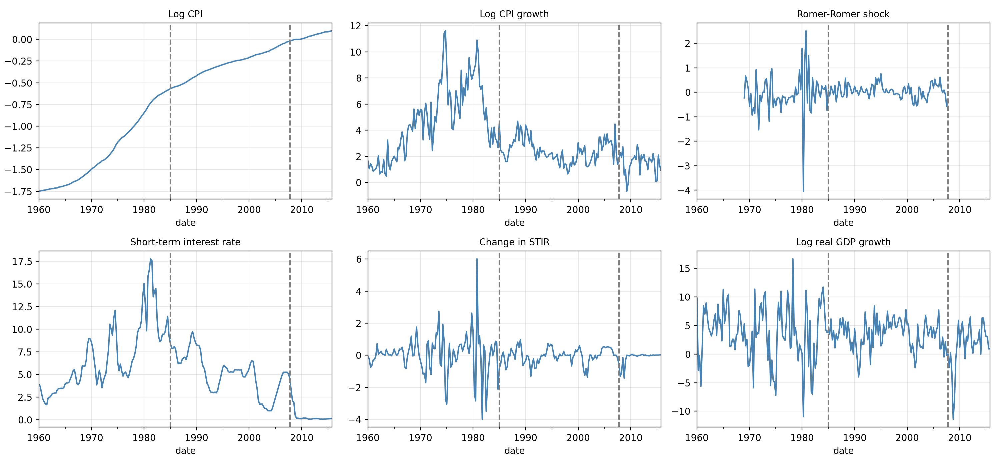
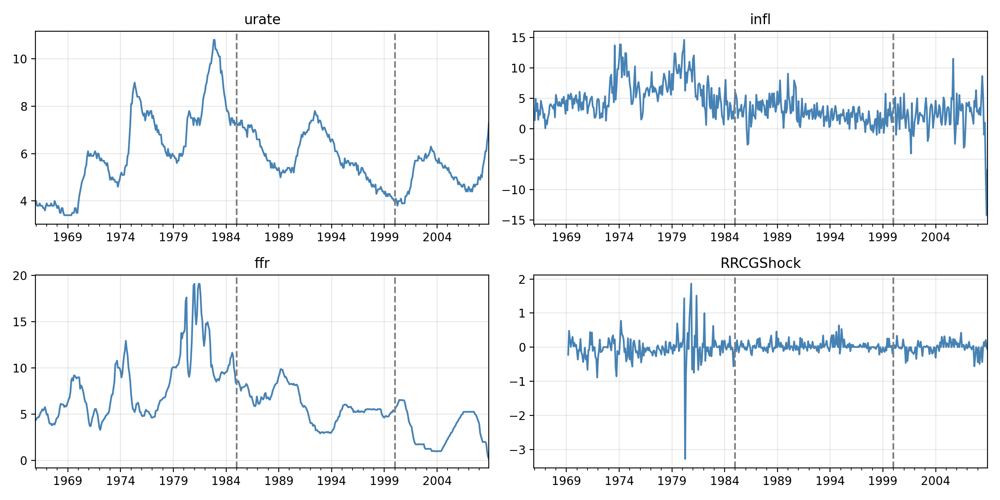
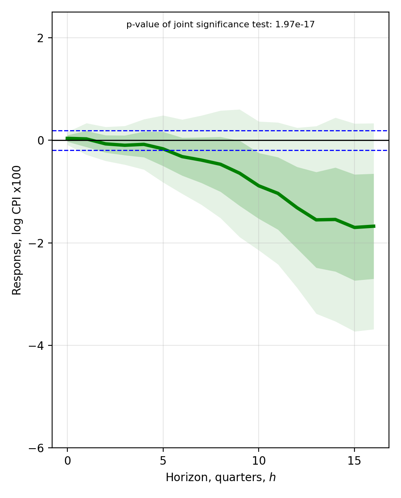
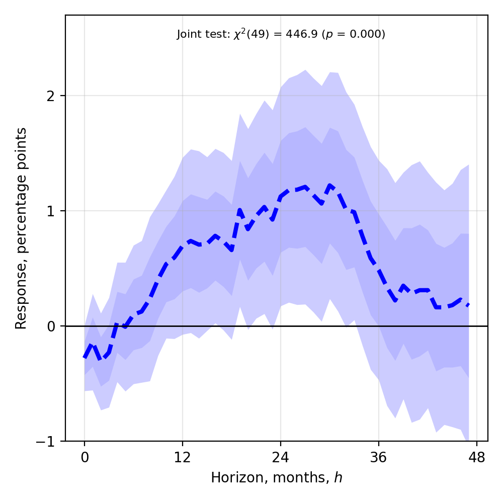

# Local Projections for Monetary Policy: A Python Replication of Jordà and Taylor (2025), Figures 5 and 6

[](https://colab.research.google.com/github/muhammadabdullahz/Local-Projections-jorda-taylor/blob/main/notebooks/jorda_taylor_lp.ipynb)

An independent Python replication of Figures 5 and 6 in Jordà and Taylor's "Local Projections" (*Journal of Economic Literature*, 2025). It estimates the effects of monetary policy shocks on U.S. prices and unemployment using local projections (LP) and instrumental-variable local projections (LP-IV), implements the Frisch-Waugh-Lovell residualisation, 2SLS, Newey-West HAC inference, joint Wald tests and Bonferroni bands from scratch, and validates every estimate against the published Stata results.

## Research Question

How does a contractionary monetary policy shock affect the U.S. price level and the unemployment rate over time, and can the published Stata local-projection results be reproduced exactly in Python?

The project replicates two empirical examples from the paper:

| Paper result | What it shows | Method |
|---|---|---|
| Figure 5 | Response of the log CPI to a Romer-Romer monetary policy shock (quarterly) | LP, shock as the regressor |
| Figure 6 | Response of the unemployment rate to a federal funds rate change (monthly) | LP-IV, shock as the instrument |

## Data

| Item | Figure 5 (sheet `Ex5`) | Figure 6 (sheet `Ex6`) |
|---|---|---|
| Frequency | Quarterly | Monthly |
| Full file | 1960Q1 to 2007Q4 (224 observations) | Monthly data from the replication file |
| Estimation sample | 1985Q1 to 2007Q4 (92 observations) | January 1985 to January 2000 (181 observations) |
| Variables | Romer-Romer shock (`rr_shock`), log CPI (`lcpi`), CPI growth (`dlcpi`), short-term interest rate (`stir`), its change (`dstir`), log real GDP (`lrgdp`), real GDP growth (`dlrgdp`) | Unemployment rate (`urate`), inflation (`infl`), federal funds rate (`ffr`), Romer-Romer shock (`RRCGShock`), Kuttner shock (`KuttnerShock`) |

The data file `JT2025_Data.xlsx` comes from the replication materials in the VAR Toolbox of Ambrogio Cesa-Bianchi (Bank of England): https://github.com/ambropo/VAR-Toolbox/tree/main/Replic/JT2025

Following the original Stata code:

- The sample is cut **before** any lags or leads are constructed, so the lags and leads use only observations inside the sample.
- Log CPI and log real GDP are multiplied by 100 so that differences are in percent. `dlcpi` and `dlrgdp` are left as they are.
- The Romer-Romer shock has 68 missing values in the full file but none inside the 1985Q1 to 2007Q4 sample. The Kuttner shock has 53 missing values in the monthly sample, which matters only for the alternative-instrument extension.

## Exploratory Analysis

**Quarterly data (Figure 5).** The log CPI trends upward, and its growth rate is much more volatile in the 1970s and early 1980s, when inflation was high. The short-term interest rate is high and variable early on and trends down afterwards. Real GDP growth is far more volatile than the level of GDP.



*Figure 1. Quarterly series used for Figure 5. Dashed lines mark the 1985Q1 to 2007Q4 estimation sample.*

**Monthly data (Figure 6).** Unemployment is cyclical and peaks in recessions. The federal funds rate peaks above 15% around the early 1980s and then drifts down. The Romer-Romer shock series shows the unexpected component of policy decisions.



*Figure 2. Monthly series used for Figure 6. Dashed lines mark the January 1985 to January 2000 estimation sample.*

## Methodology

### Figure 5: Local projections with Romer-Romer shocks

At each horizon h = 0, …, 17 the dependent variable is the cumulative change in the log CPI relative to the quarter before the shock:

<p align="center">
  
</p>

Each regression controls for six lags of real GDP growth, CPI growth and the change in the short-term interest rate (18 controls in total). The implementation follows these steps:

1. **Frisch-Waugh-Lovell.** The shock and each horizon's outcome are residualised on the lagged controls. The shock is residualised once on the h = 0 sample (86 observations), giving the residual , and each outcome gives .
2. **Impulse response.** The coefficient at each horizon is the OLS slope of the residualised outcome on the residualised shock:

<p align="center">
  
</p>

3. **Stacking.** Observations from the 18 horizons are stacked (1,395 in total), and the regression residuals are computed as:

<p align="center">
  
</p>

4. **Joint HAC covariance.** The moment contributions  form a time-by-horizon matrix. A Newey-West estimator with a Bartlett kernel and 17 lags gives the covariance across horizons, and a finite-sample correction is applied.
5. **Joint test.** An F-test (18 and 85 degrees of freedom) of the null that all 18 coefficients are zero:

<p align="center">
  
</p>

6. **Bonferroni band.** A common significance threshold for the 5% level across 18 horizons, drawn as blue dashed lines on the figure.

### Figure 6: LP-IV with the Romer-Romer shock as instrument

At each horizon h = 0, …, 48 the unemployment rate is regressed on the federal funds rate, treated as endogenous:

<p align="center">
  
</p>

The controls  are six lags of unemployment, inflation and the funds rate. The funds rate is instrumented with the contemporaneous Romer-Romer shock and its six lags (seven excluded instruments):

<p align="center">
  
</p>

1. **Residualisation.** All 49 outcomes, the funds rate and the instrument are residualised on the 18 lagged controls. Lags of the residualised instrument are then built.
2. **Common sample.** Dropping missing values leaves 121 monthly observations (January 1986 to January 1996) shared by all 49 equations. The end date is set by the 48 leads needed for the longest horizon.
3. **2SLS.** All 49 horizons are estimated simultaneously from the same projection matrices.
4. **Joint HAC covariance.** A Newey-West estimator (Bartlett kernel, 6 lags) covers all 49 equations jointly.
5. **Joint test.** A Wald test (chi-squared with 49 degrees of freedom) of the null that all coefficients are zero:

<p align="center">
  
</p>

6. **Instrument strength.** A non-robust first-stage F-test on the seven excluded instruments.

## Results

### Validation against Stata

The main goal was an exact match with the published Stata output. It was achieved for both figures.

**Figure 5 (LP)**

| Check | Python | Stata |
|---|---|---|
| Stacked observations | 1,395 | 1,395 |
| Time periods (T) | 86 | 86 |
| Max abs. difference in coefficients | 0.000001 | – |
| Standard error ratio (Stata / Python) | 1.0000 to 1.0000 | – |
| Joint F-statistic | 13.02 | 13.02 |
| Joint test p-value | 1.97 × 10⁻¹⁷ | – |
| Mean squared residualised shock | 0.047764 | 0.047764 |
| HAC s.e. of the contemporaneous moment | 0.003062 | 0.003062 |
| Bonferroni band | ± 0.1918 | – |

**Figure 6 (LP-IV)**

| Check | Python | Stata |
|---|---|---|
| Observations | 121 | 121 |
| Joint Wald χ²(49) | 446.89 | 446.89 |
| Joint test p-value | 1.3 × 10⁻⁶⁵ | – |
| Max abs. difference in coefficients | 0.000000 | – |
| Standard error ratio (Stata / Python) | 1.0000 to 1.0000 | – |
| First-stage F (non-robust) | 6.0 | – |

### Figure 5: Response of the CPI to a Romer-Romer shock

<p align="center">
  
</p>

*Figure 3. Cumulative response of the log CPI (×100) to a Romer-Romer shock, horizons 0 to 16 quarters. Green line: LP coefficients. Shaded: 68% and 95% HAC bands. Blue dashed: Bonferroni significance thresholds.*

Selected coefficients (identical in Python and Stata to six decimals):

| Horizon (quarters) | Coefficient | HAC s.e. |
|---|---|---|
| 0 | 0.037 | 0.064 |
| 4 | −0.080 | 0.251 |
| 8 | −0.468 | 0.535 |
| 12 | −1.315 | 0.796 |
| 16 | −1.676 | 1.025 |

The response is close to zero on impact and becomes steadily more negative, reaching about −1.7 (log CPI × 100, so roughly 1.7% below the pre-shock price level) by the end of the horizon. Individual coefficients are imprecise, with standard errors close to one at long horizons, but the joint test rejects at any conventional level (F = 13.02).

### Figure 6: Response of unemployment (LP-IV)

<p align="center">
  
</p>

*Figure 4. Unemployment response to a federal funds rate increase. Dashed blue: LP-IV coefficients. Shaded: 68% and 95% HAC bands. Following the published figure's indexing convention, coefficients for h = 1, …, 48 are plotted at horizons 0 to 47.*

Selected coefficients (identical in Python and Stata):

| Horizon (months) | Coefficient | HAC s.e. |
|---|---|---|
| 0 | −0.106 | 0.104 |
| 12 | 0.596 | 0.360 |
| 24 | 0.925 | 0.486 |
| 31 (peak) | 1.222 | 0.502 |
| 36 | 0.591 | 0.493 |
| 48 | 0.177 | 0.627 |

A 1 percentage point rise in the funds rate is followed by little change in unemployment in the first months, then a rise that peaks at about 1.2 percentage points around two and a half years out, and a gradual fade afterwards. The joint test strongly rejects zero response at all horizons (χ²(49) = 446.89).

## Conclusions

- **The replication is exact.** For both figures, coefficients match Stata to six decimals, standard errors match to four, and the joint test statistics, sample sizes and significance bands agree.
- **Contractionary shocks lower prices slowly.** The CPI response is negligible on impact and builds over several years.
- **Contractionary policy raises unemployment with a lag.** The peak effect arrives roughly two to three years after the rate change.
- **Joint inference matters.** Individual horizon estimates are often imprecise, and the joint HAC tests are what establish that the response is non-zero.

## Limitations

- **Weak-instrument concern.** The non-robust first-stage F-statistic in the LP-IV is 6.0, below the usual rule-of-thumb of 10. The 2SLS estimates and their confidence bands should be read with caution. The robust version of this statistic was not computed.
- **Long horizons are imprecise.** Standard errors at long horizons are large relative to the coefficients, so the shape of the response there is uncertain.
- **Short samples.** Figure 5 uses 86 effective quarterly observations and Figure 6 uses 121 monthly observations, and the shocks are available for a limited period.
- **Identification.** Both figures rely on Romer-Romer shocks being valid as exogenous policy variation (the shock in Figure 5, the instrument in Figure 6).
- **Alternative instrument not reported.** The code can use the Kuttner shock in place of the Romer-Romer shock, but this extension is not reported here and there are no Stata benchmarks to validate it against.
- **Stata benchmarks are hard-coded.** The notebook compares against Stata numbers stored in the code rather than re-running Stata.

## Repository Structure

```
├── README.md
├── notebooks/
│   └── jorda_taylor_lp.ipynb
├── data/
│   └── raw/            # JT2025_Data.xlsx
└── outputs/
    └── figures/
        ├── Figure5a_python.png
        ├── Figure6a_python_published.png
        ├── eda_fig5.png
        └── eda_fig6.png
```

## Reproducing the Results

The notebook is written for Google Colab and reads the data from Google Drive. To run it:

1. Download `JT2025_Data.xlsx` (see the source below) and put it in a Drive folder, for example `MyDrive/LocalProjections/`.
2. Open the notebook in Colab with the badge at the top, and set `PATH` in the first code cell to the file's location. Figures are saved to the path set in `SAVE_PATH` in the two plotting cells.
3. Run the cells from top to bottom. The required libraries are `numpy`, `pandas`, `matplotlib`, `statsmodels`, `scipy` and `openpyxl` (for reading the Excel file), all preinstalled in Colab except possibly `openpyxl`.

Everything runs in seconds.

## Data Source and Credits

- Jordà, Ò. and Taylor, A. M. (2025). Local Projections. *Journal of Economic Literature*.
- Data: `JT2025_Data.xlsx` from Ambrogio Cesa-Bianchi's VAR Toolbox, https://github.com/ambropo/VAR-Toolbox/tree/main/Replic/JT2025
